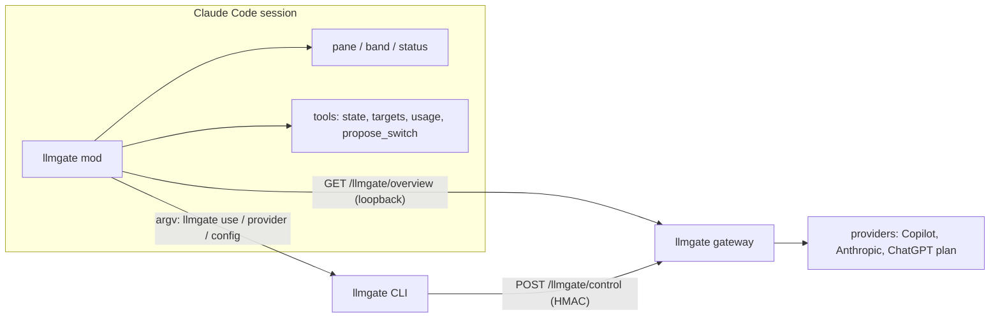

# The llmgate mod: control the gateway from inside Claude Code

Status: design (BET-5). Built so far: M0 (the spike), M1 (the pane with Now and Targets, `mods/llmgate/`) and most of M2 and M3: `GET /llmgate/overview`, the ledger by provider, the `pricing` table, the captured Anthropic rate-limit headers and the pane's Usage view. Built from M4: the `/llmgate status|targets|usage|use` subcommands, the status entry and the toasts (the remaining subcommands wait for the slices that own them: `models` and `doctor` for M3's Health tab, `apply` and `dismiss` for M5). Not yet built from M2: the Copilot quota adapter. Decisions are the owner's answers of 2026-10-21; facts about what a
mod can do come from the mods documentation (https://code.claude.com/docs/en/plugins/mods/overview, `interface`,
`events`, `api`) and from the `plugin-authoring` types of Claude Code 2.1.306, marked where only documented.

## What a mod is, and what that gives us

A mod is a plugin of JavaScript or TypeScript handlers that run inside Claude Code (CLI, Desktop app, VS Code
extension; hooks also run under `claude -p`, drawing does not). It can draw a pane or a band with buttons and
fields, register slash commands and model-callable tools, hold a tool call while the person answers, keep state
(`$.state` for the session, `$.store` across sessions), run a host command by argv (`$.process.run`), fetch a URL
through the host (`$.http.fetch`), read and write files, and run timers (`$.clock.every`). It runs with the user's
permissions and is not sandboxed; it cannot change the permission prompt, and a mod's approval does not pass an
`ask` rule under managed settings.

Limits that shape the design:

| Fact | Consequence |
|---|---|
| A hook has 10 seconds of its own code per dispatch; time inside a `$` call does not count | A held call waits in `$` calls (the `blast-radius` sample loops on `$.process.run(["sleep", ...])`), never in module code |
| A pane the mod opens by itself seats only from 144 columns (110 once the person opened it themselves); one opened by a command or press seats at any width. `$.ui.open` resolves `{ isPlaced }` | The model's proposal may not be placeable; the band above the prompt is the fallback, and with neither drawn the tool says it cannot ask |
| The band is shared by every mod and a mod's tree replaces the ones after it | Draw the proposal in the pane first, the band second, and refuse after 10 minutes when no button shows |
| Redraws are throttled and coalesced; a timer drives polling | One `$.clock.every` poll of the overview, `$.ui.invalidate` on a change |
| VS Code: no button hotkeys, status line cut at 200 characters, panes seat from 800 px; `Input` and `Select` work, `Raster` is terminal-only | Terminal first; VS Code is a checked later step |
| A WSL session of the Desktop app loads no plugins; `-p` draws nothing | Not supported there; commands still answer text under `-p` |
| The API is early access and moves between releases | The compatibility run records the Claude Code version; `claude plugin validate` is part of the gate |

## Decisions

| # | Decision |
|---|---|
| M1 | **Needs:** switch live; see live state; diagnose and fix; onboard and configure; choose which models of which provider serve which role; one overview of usage and cost across all providers. |
| M2 | **Forms:** a live pane, slash commands, a status entry with toasts, and model-callable tools. The first deliverable is the pane (slice M1, owner's choice). |
| M3 | **Authority:** the model may propose a switch; nothing changes until the person approves. Reads are free for the model; every write is a person-initiated action. |
| M4 | **Approval is a button in the pane.** The model's `propose_switch` tool call is **held up to 10 minutes** (like `blast-radius`) while the pane or band shows Apply and Dismiss; Dismiss has the focus, Esc and an interrupt refuse, and the model gets the real outcome (applied, dismissed, timed out, interrupted, cannot ask). |
| M5 | **No pane placed:** the proposal is drawn as a band above the prompt with the same buttons; where nothing can draw (headless), the tool answers that it cannot ask and changes nothing; `/llmgate apply` and `/llmgate dismiss` act on the pending proposal. |
| M6 | **Scope:** a switch applies to this session by default (the per-session remap); a second button, "make default", applies it globally (the role remap `llmgate use` makes today). |
| M7 | **Channel:** writes go through the `llmgate` CLI by argv (never a shell), so identity, authority and validation stay in one place; the pane reads a new read-only `GET /llmgate/overview` over loopback. |
| M8 | **Config edits** are CLI commands that change only the named keys, keep comments, validate, print a diff and write only with `--yes` (`llmgate provider add\|refresh\|remove`, `llmgate config set PATH VALUE`, `llmgate routes set ROLE a,b`; spec L4 of docs/provider-presets.md). The mod shows the diff in the pane and runs the command on Apply. |
| M9 | **Usage and cost:** ledger tokens per provider, model and day, priced from a pricing table the owner maintains (unknown price shown as unknown, never guessed), plus a quota adapter per provider where a route offers one (Copilot now; Anthropic from the `anthropic-ratelimit-unified-*` headers the gateway passes through, captured per provider; ChatGPT only if a route allows it). |
| M10 | **Pane v1 sections:** Now (route, via, circuit, switch buttons per role), Targets (every model per provider, usable or disabled, limits), Usage (tokens, requests, cost, quota, budget), Health and Config (doctor findings with fix buttons, config problems, pending proposals). |
| M11 | **Status:** the mod owns the status entry (`$.ui.status`: provider, model, via, fallback, quota); `llmgate setup` stops installing the `statusLine` command into a profile that gets the mod; `llmgate statusline` stays for sessions without it. |
| M12 | **Activation:** `llmgate claude` and `llmgate setup` add `--plugin-dir` for the mod folder shipped with the binary, so it is versioned with the gateway and appears only in llmgate sessions. |
| M13 | **Delivery:** in this repository, `mods/llmgate/`, Apache-2.0, with a README that says what the mod does and calls (`claude plugin validate` output). |
| M14 | **Surfaces:** terminal first; the Desktop app and VS Code are checked after the bet's smallest test. |
| M16 | **Labels** on providers and models (display, usage by label, filter, a guard against crossing work and private): [docs/labels.md](labels.md). |
| M15 | **Name:** the mod and its commands are `llmgate`; `/llmgate` replaces `/gateway` (kept as an alias for one release). |

## Architecture

The overview (`schema_version` 1) holds: the session's route (as `/llmgate/route`), every provider's circuit and
counters, usage by provider and model for today and the month with priced cost where a price is known, quota
lines per provider, the budget, the targets with their usable mark and limits (from the discovery cache of
`llmgate models`), and the config problems and doctor findings that need no network. It never holds a token, an
account id, a base URL or a host: a provider is named by its config key. The gateway address is read from
`ANTHROPIC_BASE_URL` in the session's environment; the binary from `LLMGATE_BIN` (set by the launcher) or the PATH.

## Slices (each carries `Bet: BET-5`)

| Slice | Content | Gate |
|---|---|---|
| M0 | **Spike**, one day: a skeleton mod with a `/llmgate-ping` command that opens a pane, runs `llmgate targets` by argv and fetches `/llmgate/route` over loopback. Settles what is assumed here: that `$.http.fetch` reaches loopback, that `$.session.id()` and the environment are readable, that a command can open a pane at any width, and what `claude -p "/llmgate ..."` prints | `claude plugin validate`; findings written into this document |
| M1 | **Pane first: Now and Targets** with the session switch buttons and "make default" (decisions M6, M7), built on what the gateway already serves (`GET /llmgate/route`, the target list through the CLI), so the first week shows a working pane | `claude plugin test`, a real session |
| M2 | The gateway's `GET /llmgate/overview`, its contract and golden test, the pricing table in the config, usage cost, the Anthropic rate-limit header capture, the Copilot quota adapter; the pane moves onto it | unit, e2e against the fakes |
| M3 | Pane: Usage, then Health and Config (read-only), on the overview | `claude plugin test` |
| M4 | Commands (`/llmgate status\|targets\|use\|models\|doctor\|usage\|apply\|dismiss\|pane`) and the status entry with toasts for fallback, stall and quota | `claude plugin test`, e2e under `-p` if M0 allows |
| M5 | `propose_switch` with the hold, the band fallback, the read-only tools | `claude plugin test` including the refusal paths, a real session |
| M6 | The CLI that edits config (`provider add\|refresh\|remove`, `config set`, `routes set`) and the pane's diff-and-Apply flow | unit, e2e, real session |
| M7 | Launcher and setup integration (`--plugin-dir`, the status line move, `/gateway` alias), README | `llmgate_setup_flow`, compat |
| M8 | VS Code and Desktop check, the evidence and the decision of 2026-11-20 | a real run per surface |

## Safety and privacy

- The mod runs with the owner's permissions and is not sandboxed; its README lists what it calls so that `claude plugin validate` output can be compared with it.
- Every `llmgate` invocation is an argv list; nothing from a model or a config value is ever put into a shell string. Values from the model (`role`, `target`, `scope`, `reason`) are checked against the catalogue before they reach argv, and the reason is shown, never executed.
- Text from providers, config keys and error bodies is passed through the same printable-only filter as `llmgate models` before it is drawn.
- The overview and the pane show provider names (config keys), model ids and numbers; no token, account id, base URL or company host. Test data uses invented providers.
- A held proposal is refused, not applied, on any doubt: timeout, interrupt, a second proposal replacing it, a changed catalogue, or a gateway that no longer answers.
- A mod's approval cannot pass the permission prompt; the mod's tools are not auto-allowed.

## M0 findings (spike run 2026-10-21, Claude Code 2.1.306, terminal, headless)

A skeleton mod with one command ran under `claude -p "/llmgate-ping" --plugin-dir DIR` through an llmgate session
and reported what it could reach:

| Question | Answer |
|---|---|
| Does `claude -p "/mod-command"` run a mod's command? | **Yes.** The command runs its function with no model turn and prints its text, prefixed with the plugin name |
| Does `$.http.fetch` reach the loopback gateway? | **Yes.** `GET /healthz` and `GET /llmgate/route?session=ID` both answered 200 |
| Is the session id readable, and is it the one the gateway keys on? | `$.session.id()` answers it, and after `--resume` it equals the first run's id, so `/llmgate/route?session=` and the per-session remap can be keyed by it |
| Is the gateway address readable? | **Yes.** `$.env.get('ANTHROPIC_BASE_URL')` gives `http://127.0.0.1:PORT/anthropic`; strip `/anthropic` |
| Is the `llmgate` binary on the mod's PATH? | **No.** `$.process.run(['llmgate', ...])` failed with ENOENT. The launcher must export `LLMGATE_BIN` (and `LLMGATE_CONFIG`) for the mod, and the mod runs the binary by absolute path; by absolute path it started and ran |
| Does a command-opened pane place in a real session? | **Yes** (owner's run, Claude Code Desktop app, Code tab, 2026-10-21): `$.ui.open` from the command resolved `isPlaced: true` and the pane docked on the right of the transcript, drawing the mod's text; the same text also printed in the transcript. Terminal and VS Code placement are checked in M1 and M8 |
| Does `llmgate targets` run from the mod? | It ran and exited 1 with "the gateway is down" because it used the default config (port 9480) while the session's gateway was on another port: the mod's commands must run with the session's config, which `LLMGATE_CONFIG` carries (decision M12) |
| Does a pane place under `-p`? | No: `isPlaced: false`, reason `no-surface`, as documented. Placement in a real terminal (a command-opened pane at any width) is documented and is checked in M1 |

So decision M12 gains a duty: the launcher exports `LLMGATE_BIN` and `LLMGATE_CONFIG` into the session, and the
CLI reads `LLMGATE_CONFIG` when no `--config` is given (to be built in M7).

## Open questions

1. The pricing table's place and shape: a `pricing` section in the config or a separate file, and per-million-token units for input, output, cache read and cache write.
2. Whether the Anthropic rate-limit headers are enough for a quota line, or the subscription's own usage endpoint is needed.
3. Whether the CLI should read `LLMGATE_CONFIG` itself or the mod should always pass `--config`.
